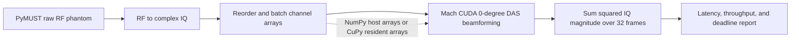

# Realtime Beamforming Lab

A personal exploration of latency-sensitive ultrasound processing. The project follows the raw-channel-data path that feeds functional ultrasound imaging (fUSI): RF-to-IQ conversion, image reconstruction with GPU delay-and-sum beamforming, and a Power Doppler-style output. It uses public phantom data so those computational stages can be studied without a brain recording or ultrasound hardware.

## How fUSI processing works

fUSI tracks changes in ultrasound speckle caused in part by moving blood cells. A common processing path is:

1. **Acquire repeated plane-wave channel data.** An array transmits unfocused plane waves and records the returning RF signal at each element. Multiple steering angles may be acquired for each time point.
2. **Convert RF to complex IQ.** Demodulation moves the signal to baseband while preserving phase information used in Doppler processing.
3. **Reconstruct an image sequence.** Delay-and-sum (DAS) beamforming maps channel samples onto image locations. With multiple transmit angles, the complex images can be coherently compounded.
4. **Suppress tissue clutter and motion.** Motion correction and temporal/spatiotemporal filters, often based on singular value decomposition (SVD), help separate blood-related signal from tissue and bulk motion.
5. **Estimate Power Doppler over time.** A temporal statistic of the filtered complex images highlights moving-scatterer activity. The resulting maps can then be analyzed over time or related to a task or stimulus.

This is a shared outline rather than a single mandated recipe: acquisition sequences, clutter filters, and Power Doppler estimators vary. The [fUSI processing overview](https://www.neuroai.science/p/functional-ultrasound-imaging-from) is the main conceptual reference for this project; the [mach Doppler example](https://forest-neurotech.github.io/mach/examples/doppler.html) documents the raw-RF-to-beamformed-Doppler path used for the active sample.

## Data in this project

The raw datasets are downloaded or cached locally and are not checked into Git. The two selectable inputs are complementary: one is a small controlled Doppler workload, while the other is a larger multi-angle beamforming benchmark.

| Dataset | What it contains | Questions it lets us ask |
| --- | --- | --- |
| **PyMUST rotating-disk phantom** — active | About 2.1 MB of measured raw RF channel data from a tissue-mimicking phantom with a rotating disk that creates controlled Doppler shifts. The example describes a 128-element array, 334 fast-time samples, 32 slow-time frames, and 10 kHz PRF. The current loader uses a 0° plane-wave geometry. | Can RF-to-IQ, DAS, and a Doppler-style reduction be checked end to end? How much time is spent in conversion, copies, kernel launches, and reduction? How do batch size and host-versus-GPU-resident arrays affect throughput and tail latency on a repeatable small workload? |
| **PICMUS experimental resolution/distortion phantom** — selectable | About 146 MB of experimental phantom channel data in UFF format. The mach example describes a 128-element array and 75 plane-wave transmissions from −16° to +16° for the resolution dataset. It is loaded and coherently compounded through mach's UFF adapter. | How does runtime and memory traffic scale with many transmit angles? Does multi-angle coherent compounding match expected target geometry and image quality? Which beamforming and data-movement costs appear on a larger standardized channel-data workload? |

The PyMUST sample is useful for temporal Doppler accumulation and repeatable latency experiments; PICMUS is useful for multi-angle compounding and image-quality checks. Neither is a brain fUSI recording, so they support ultrasound-pipeline and systems questions rather than biological or task-decoding conclusions. See [DATA_PROVENANCE.md](DATA_PROVENANCE.md) for source versions, citations, transformations, and licensing notes. The [USTB dataset catalog](https://unioslo.github.io/USTB/datasets.html) lists the PICMUS files as channel data, and mach's [plane-wave compounding example](https://forest-neurotech.github.io/mach/examples/plane_wave_compound.html) demonstrates the 75-angle workflow.

## Current benchmark pipeline



The default PyMUST path covers a raw-data-to-Doppler front end: it beamforms the 32-frame phantom ensemble and sums squared complex-IQ magnitude. It does not perform multi-angle coherent compounding, motion correction, SVD clutter filtering, or task-level functional analysis. The PICMUS path adds multi-angle compounding on a separate single-frame image-quality workload.

## Role of Forest Neurotech and mach

[mach](https://github.com/Forest-Neurotech/mach) is Forest Neurotech's open-source CUDA-accelerated delay-and-sum beamforming library. It is the GPU beamforming engine used by this project: the PyMUST path calls its single-wave kernel, while the PICMUS path calls `mach.experimental.beamform()` to beamform and coherently compound all transmit angles. mach supports NumPy and GPU-array inputs, including CuPy.

This repository owns the experiment around that kernel: selecting and loading data, preparing layouts and geometry, deciding whether arrays stay on the GPU between runs, reducing or saving the image, and measuring latency, transfers, and deadline misses. It does not implement the optimized DAS kernel itself; [exercise 6](exercises/06-custom-das-kernel.md) is the planned place to build a reference kernel and compare it with mach. The PICMUS path uses mach's experimental compounding API, so its behavior may change across versions; the optional dependency currently stays within the `0.2.x` series.

The benchmark compares two input paths:

- **`numpy`** passes host arrays to mach for each beamforming call. This includes the library's host/device transfer behavior.
- **`cupy`** keeps inputs on the GPU across repeated beamforming calls. For PyMUST it uploads the IQ ensemble once per run; for PICMUS it uploads channel data and geometry once before the measured runs. Power Doppler accumulation or coherent compounding then runs through mach on the resident arrays.

Mach's docs specify IQ input as contiguous `(elements, samples, frames)` arrays and note that host arrays add CPU/GPU transfer latency. The benchmark reports whole-pipeline wall time separately from CUDA-event beamforming time so those costs are visible.

## Requirements

The CUDA benchmark requires Python 3.11+, Linux, an NVIDIA GPU with compute capability 7.5 or newer, and a compatible driver. The current mach wheel requires CUDA driver 12.8 or newer and glibc 2.34 or newer. A Mac can be used to read and edit the project, but the CUDA path must run on an NVIDIA host or GPU-enabled remote environment.

Use two environments for this experiment:

- **Google Colab for setup and smoke checks.** Select a GPU runtime, install the project, confirm `nvidia-smi` and run each dataset for a few iterations. Colab's GPU type, availability, and session limits vary, so use those results to check installation, loading, and numerical output rather than to compare tail latency. See the [Colab FAQ](https://research.google.com/colaboratory/faq.html).
- **RunPod or Lambda for profiling and benchmark results.** Use a Linux single-GPU instance that meets the requirements above. Put the checkout, reports, and profiler traces on persistent storage, such as a RunPod network volume or an attached Lambda filesystem. The dataset cache is managed by the libraries and may live on ephemeral storage, so it can be downloaded again after replacing the instance. Use one instance/GPU type for each comparison, record its runtime metadata, and run unprofiled latency measurements separately from short Nsight Systems captures. See [RunPod Pod connections](https://docs.runpod.io/pods/connect-to-a-pod), [RunPod network volumes](https://docs.runpod.io/storage/network-volumes), [Lambda On-Demand Cloud](https://docs.lambda.ai/public-cloud/on-demand/), [Lambda filesystems](https://docs.lambda.com/public-cloud/filesystems/), and NVIDIA's [Nsight Systems install guide](https://docs.nvidia.com/nsight-systems/InstallationGuide/).

```bash
python -m venv .venv
source .venv/bin/activate
python -m pip install -e '.[gpu]'
```

The `gpu` extra uses the CUDA 12 CuPy wheel for Linux GPU hosts. The `gpu-colab` extra uses the CUDA 13 wheel available in the current Colab GPU runtime. Both include mach's example dependencies: PyMUST for RF-to-IQ conversion and `pyuff-ustb` for PICMUS UFF input. Keeping the CuPy variants separate avoids installing both runtime wheels in one environment.

## Run it

### Colab: install and verify the pipeline

In Colab, choose **Runtime → Change runtime type → GPU**, then run these cells. The short runs are smoke checks; their latency numbers are not a benchmark.

```python
!git clone https://github.com/vickgidwani/realtime-beamforming-lab.git
%cd realtime-beamforming-lab
!nvidia-smi
%pip install -e '.[gpu-colab]'
```

If this Colab runtime already has a CUDA 12 CuPy wheel or a mixed CuPy installation, remove both variants, reinstall the Colab extra, then restart the runtime before importing CuPy:

```python
%pip uninstall -y cupy-cuda12x cupy-cuda13x
%pip install --no-cache-dir -e '.[gpu-colab]'
```

Uninstalling only one variant can leave the shared `cupy` package files incomplete. The [Exercise 1 Colab notebook](exercises/01-transfer-path.ipynb) provides the matched NumPy/CuPy benchmark, output analysis, and plots for the VS Code Colab extension. It installs the local checkout, so upload the current project folder to a fresh runtime before running it.

```python
!beamform-lab benchmark --dataset pymust --mode cupy --runs 2 --warmup 0 \
  --batch-size 32 --output artifacts/colab-pymust.json

!beamform-lab benchmark --dataset picmus --mode cupy --runs 1 --warmup 0 \
  --save-image artifacts/colab-picmus.npy \
  --output artifacts/colab-picmus.json
```

Colab runtimes are temporary. Download any JSON reports or image arrays you want to keep before disconnecting; the datasets can be downloaded again on the next runtime.

### RunPod or Lambda: measure and profile

Attach or mount persistent storage when creating the instance, then run the commands from that mount point. This keeps the checkout and benchmark artifacts when the GPU instance is stopped or replaced. On Lambda, attach the filesystem at instance launch; RunPod network volumes can be attached to Pods. Clone the repository, install the same optional dependencies, and record the exact environment before measuring:

```bash
git clone https://github.com/vickgidwani/realtime-beamforming-lab.git
cd realtime-beamforming-lab
python3 -m venv .venv
source .venv/bin/activate
python -m pip install -e '.[gpu]'
nvidia-smi
mkdir -p artifacts
python -m pip freeze > artifacts/pip-freeze.txt
```

Run the host-array and GPU-resident paths on the same instance. Use a longer unprofiled run for latency percentiles and save the JSON, image, and environment record on the instance's persistent storage:

```bash
beamform-lab benchmark --mode numpy --runs 200 --batch-size 32 \
  --deadline-ms 10 --output artifacts/numpy.json

beamform-lab benchmark --mode cupy --runs 200 --batch-size 32 \
  --deadline-ms 10 --save-power artifacts/power_doppler.npy \
  --output artifacts/cupy.json

beamform-lab benchmark --dataset picmus --mode numpy --runs 20 --warmup 2 \
  --save-image artifacts/picmus-host.npy --output artifacts/picmus-host.json

beamform-lab benchmark --dataset picmus --mode cupy --runs 20 --warmup 2 \
  --save-image artifacts/picmus-device.npy --output artifacts/picmus-device.json
```

Then capture a short Nsight Systems trace to inspect copies, synchronization, and GPU gaps. Tracing adds overhead, so don't use traced runs for the final latency percentiles:

```bash
nsys profile --trace=cuda,nvtx,osrt --output=artifacts/picmus-cupy \
  beamform-lab benchmark --dataset picmus --mode cupy --runs 3 --warmup 1
```

If `nsys` is not installed on the instance, install the CLI using NVIDIA's [Nsight Systems guide](https://docs.nvidia.com/nsight-systems/InstallationGuide/). Keep traces and result files outside the Git checkout or in its ignored `artifacts/` directory; download them before terminating the instance.

Mach downloads and caches the PyMUST raw-RF sample on the first run. `--dataset picmus` downloads the 145.5 MB PICMUS UFF file and verifies its expected SHA-256; later runs reuse the cache. Try PyMUST `--batch-size 1`, `4`, `8`, and `32` to see how launch overhead, chunk copies, and the number of calls change. The default PyMUST 251 × 251 scan grid has 63,001 points; use `--grid-size` to change the grid. PICMUS uses its native 387 × 609 scan and compounds all 75 angles per run; `--batch-size` and `--grid-size` apply only to PyMUST.

The PyMUST report includes p50/p95/p99/p99.9 and max ensemble latency, deadline misses, frames per second, RF-to-IQ time, upload time, wall time, device beamforming time, and an output feature for comparing the two paths. It also reports a conservative first-acquisition-to-output estimate: acquisition-window duration + RF-to-IQ + measured pipeline time. This assumes those stages run serially; a real system can overlap acquisition, transfer, and compute. The PICMUS report gives per-image reconstruction percentiles for one pre-acquired frame; its deadline is a reconstruction-only proxy, not a streaming fUSI deadline.

For a system timeline on the NVIDIA host:

```bash
nsys profile --trace=cuda,nvtx,osrt \
  beamform-lab benchmark --mode cupy --runs 20 --batch-size 1
```

The sample has only 32 slow-time frames, so `--runs` repeats the same ensemble to get a latency distribution. Treat the results as a repeatable microbenchmark, not a clinical performance claim. Record the GPU model, driver/toolkit, power and thermal state, scan grid, batch size, and command with benchmark reports.

## Exercises

The [exercise index](exercises/README.md) separates runnable comparisons from extensions that still need implementation. Each exercise names its dataset, baseline, profiler signals, and success criteria. The criteria focus on repeatable observations such as transfer bytes or queue behavior; they do not promise a speedup on every GPU.

## Provenance and results

[DATA_PROVENANCE.md](DATA_PROVENANCE.md) records each raw-data source, dataset description, citation, licensing caveat, and processing steps. PyMUST reports include a fingerprint of the loaded RF array; PICMUS reports include the verified UFF file hash and embedded authorship text when available. Both include Python, package, platform, GPU, CUDA, command, and Git revision metadata where available.

Keep source data out of Git unless its terms explicitly permit redistribution. Keep large Nsight reports out of Git as well; see [results/README.md](results/README.md) for what to record and retain for an experiment.

## Data and software citations

- PyMUST rotating-disk RF sample and workflow: [mach Doppler example](https://forest-neurotech.github.io/mach/examples/doppler.html)
- PICMUS channel data and multi-angle compounding: [USTB public datasets](https://unioslo.github.io/USTB/datasets.html) and [mach plane-wave compounding example](https://forest-neurotech.github.io/mach/examples/plane_wave_compound.html)
- Beamforming implementation used by this lab: [Forest Neurotech's mach repository](https://github.com/Forest-Neurotech/mach)
- GPU beamformer: [mach documentation](https://forest-neurotech.github.io/mach/)
- Original ultrasound research toolbox: [MUST](https://www.biomecardio.com/MUST/index.html)
- The code in this repository is MIT licensed. Dataset and third-party software terms are separate; follow their published attribution and license requirements in [DATA_PROVENANCE.md](DATA_PROVENANCE.md).
