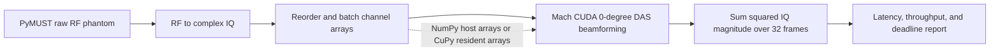

# Realtime Beamforming Lab

A personal exploration of latency-sensitive ultrasound processing. The project follows the raw-channel-data path that feeds functional ultrasound imaging (fUSI): RF-to-IQ conversion, image reconstruction with GPU delay-and-sum beamforming, and a Power Doppler-style output. It uses public phantom data so those computational stages can be studied without a brain recording or ultrasound hardware.

## How fUSI processing works

fUSI tracks changes in ultrasound speckle caused in part by moving blood cells. A common processing path is:

1. **Acquire repeated plane-wave channel data.** An array transmits unfocused plane waves and records the returning RF signal at each element. Multiple steering angles may be acquired for each time point.
2. **Convert RF to complex IQ.** Demodulation moves the signal to baseband while preserving phase information used in Doppler processing.
3. **Reconstruct an image sequence.** Delay-and-sum (DAS) beamforming maps channel samples onto image locations. With multiple transmit angles, the complex images can be coherently compounded.
4. **Suppress tissue clutter and motion.** Motion correction and temporal/spatiotemporal filters, often based on singular value decomposition (SVD), help separate blood-related signal from tissue and bulk motion.
5. **Estimate Power Doppler over time.** A temporal statistic of the filtered complex images highlights moving-scatterer activity. The resulting maps can then be analyzed over time or related to a task or stimulus.

This is a shared outline rather than a single mandated recipe: acquisition sequences, clutter filters, and Power Doppler estimators vary. The [fUSI processing overview](https://www.neuroai.science/p/functional-ultrasound-imaging-from) is the main conceptual reference for this project; the [mach Doppler example](https://forest-neurotech.github.io/mach/examples/doppler.html) documents the raw-RF-to-beamformed-Doppler path used for the active sample.

## Data in this project

The raw datasets are downloaded or cached locally and are not checked into Git. The active dataset and planned extension are complementary: one is a small controlled Doppler workload, while the other is a larger multi-angle beamforming benchmark.

| Dataset | What it contains | Questions it lets us ask |
| --- | --- | --- |
| **PyMUST rotating-disk phantom** — active | About 2.1 MB of measured raw RF channel data from a tissue-mimicking phantom with a rotating disk that creates controlled Doppler shifts. The example describes a 128-element array, 334 fast-time samples, 32 slow-time frames, and 10 kHz PRF. The current loader uses a 0° plane-wave geometry. | Can RF-to-IQ, DAS, and a Doppler-style reduction be checked end to end? How much time is spent in conversion, copies, kernel launches, and reduction? How do batch size and host-versus-GPU-resident arrays affect throughput and tail latency on a repeatable small workload? |
| **PICMUS experimental resolution/distortion phantom** — planned adapter | About 146 MB of experimental phantom channel data in UFF format. The mach example describes a 128-element, 5.2 MHz array and 75 plane-wave transmissions from −16° to +16° for the resolution dataset. It is not currently loaded by this project. | How does runtime and memory traffic scale with many transmit angles? Does multi-angle coherent compounding match expected target geometry and image quality? Which beamforming and data-movement costs appear on a larger standardized channel-data workload? |

The PyMUST sample is useful for temporal Doppler accumulation and repeatable latency experiments; PICMUS is intended for multi-angle compounding and image-quality checks. Neither is a brain fUSI recording, so they support ultrasound-pipeline and systems questions rather than biological or task-decoding conclusions. See [DATA_PROVENANCE.md](DATA_PROVENANCE.md) for source versions, citations, transformations, and licensing notes. The [USTB dataset catalog](https://unioslo.github.io/USTB/datasets.html) lists the PICMUS files as channel data, and mach's [plane-wave compounding example](https://forest-neurotech.github.io/mach/examples/plane_wave_compound.html) demonstrates a loader and beamforming workflow for the 75-angle sample.

## Current benchmark pipeline



The active implementation covers the raw-data-to-Doppler front end: it beamforms the 32-frame phantom ensemble and sums squared complex-IQ magnitude. It does not yet perform multi-angle coherent compounding, motion correction, SVD clutter filtering, or task-level functional analysis. Those are natural extensions for moving from a systems microbenchmark toward a fuller fUSI processing workflow.

The benchmark compares two input paths:

- **`numpy`** passes host arrays to mach for each beamforming call. This includes the library's host/device transfer behavior.
- **`cupy`** uploads the IQ ensemble once per run, keeps it on the GPU across beamforming batches, and accumulates Power Doppler there. Static probe and scan geometry is uploaded once before timing.

Mach's docs specify IQ input as contiguous `(elements, samples, frames)` arrays and note that host arrays add CPU/GPU transfer latency. The benchmark reports whole-pipeline wall time separately from CUDA-event beamforming time so those costs are visible.

## Requirements

The CUDA benchmark requires Linux, an NVIDIA GPU, a compatible driver and CUDA toolkit, and a GPU with compute capability 7.5 or newer. The current mach wheel documents CUDA driver 12.8 or newer and glibc 2.34 or newer. A Mac can be used to read and edit the project, but the CUDA path must run on an NVIDIA host or GPU-enabled remote environment.

```bash
python -m venv .venv
source .venv/bin/activate
python -m pip install -e '.[gpu]'
```

The optional dependency group includes mach's example dependencies, including PyMUST for RF-to-IQ demodulation, and CuPy for the GPU-resident comparison path.

## Run it

```bash
beamform-lab benchmark --mode numpy --runs 200 --batch-size 32 \
  --deadline-ms 10 --output artifacts/numpy.json

beamform-lab benchmark --mode cupy --runs 200 --batch-size 32 \
  --deadline-ms 10 --save-power artifacts/power_doppler.npy \
  --output artifacts/cupy.json
```

Mach downloads and caches the PyMUST raw-RF sample on the first run. Later runs reuse it. Try `--batch-size 1`, `4`, `8`, and `32` to see how launch overhead, chunk copies, and the number of calls change. The default 251 × 251 scan grid has 63,001 points; use `--grid-size` to change the grid and see how work scales.

The report includes p50/p95/p99/p99.9 and max ensemble latency, deadline misses, frames per second, RF-to-IQ time, upload time, wall time, device beamforming time, and an output feature for comparing the two paths. It also reports a conservative first-acquisition-to-output estimate: acquisition-window duration + RF-to-IQ + measured pipeline time. This assumes those stages run serially; a real system can overlap acquisition, transfer, and compute.

For a system timeline on the NVIDIA host:

```bash
nsys profile --trace=cuda,nvtx,osrt \
  beamform-lab benchmark --mode cupy --runs 20 --batch-size 1
```

The sample has only 32 slow-time frames, so `--runs` repeats the same ensemble to get a latency distribution. Treat the results as a repeatable microbenchmark, not a clinical performance claim. Record the GPU model, driver/toolkit, power and thermal state, scan grid, batch size, and command with benchmark reports.

## Exercises

The [exercise index](exercises/README.md) separates runnable comparisons from extensions that still need implementation. Each exercise names its dataset, baseline, profiler signals, and success criteria. The criteria focus on repeatable observations such as transfer bytes or queue behavior; they do not promise a speedup on every GPU.

## Provenance and results

[DATA_PROVENANCE.md](DATA_PROVENANCE.md) records the raw-data source, dataset description, citation, licensing caveat, and processing steps. Benchmark JSON includes an SHA-256 fingerprint of the loaded RF array plus Python, package, platform, GPU, CUDA, command, and Git revision metadata where available. The fingerprint is for the canonical loaded RF array, not the original MAT file bytes.

Keep source data out of Git unless its terms explicitly permit redistribution. Keep large Nsight reports out of Git as well; see [results/README.md](results/README.md) for what to record and retain for an experiment.

## Data and software citations

- PyMUST rotating-disk RF sample and workflow: [mach Doppler example](https://forest-neurotech.github.io/mach/examples/doppler.html)
- Plane-wave phantom and in-vivo alternatives for a future loader: [USTB public datasets](https://unioslo.github.io/USTB/datasets.html) and [mach plane-wave compounding example](https://forest-neurotech.github.io/mach/examples/plane_wave_compound.html)
- GPU beamformer: [mach documentation](https://forest-neurotech.github.io/mach/)
- Original ultrasound research toolbox: [MUST](https://www.biomecardio.com/MUST/index.html)
- The code in this repository is MIT licensed. Dataset and third-party software terms are separate; follow their published attribution and license requirements in [DATA_PROVENANCE.md](DATA_PROVENANCE.md).
