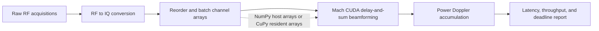

# Realtime Beamforming Lab

A personal exploration of latency-critical processing for raw ultrasound channel data. It starts with a real raw-RF dataset and runs RF-to-IQ conversion, GPU delay-and-sum beamforming with [mach](https://github.com/Forest-Neurotech/mach), and Power Doppler accumulation.

## Is this fUSI?

No. The included sample is the PyMUST rotating-disk Doppler phantom used in mach's own example. It is real raw ultrasound RF data with known probe geometry and a controlled Doppler target, but it is not brain data. The sample is small (about 2.1 MB), making it practical to download and reproduce. The benchmark follows the same RF-to-IQ and CUDA beamforming path as the mach example.

I could not find a comparably small, public fUSI recording that still contains raw per-element channel data. Public fUSI examples commonly distribute reconstructed Doppler volumes; those cannot be beamformed again. ConfUSIus documents the Nunez-Elizalde dataset as Power Doppler data, while some raw Iconeus formats are not publicly documented. This project uses raw RF so beamforming is real work in the pipeline. A later data adapter can target a public brain-ultrasound channel dataset if you want the biological domain as a second step.

The phantom lets you explore array layout, RF demodulation, transmit/receive geometry, CUDA delay-and-sum, GPU memory transfers, batching, and tail-latency measurement. It does **not** represent a brain recording or reproduce a clinical acquisition, clutter-filtering workflow, neural decoding model, or production latency target.

## Pipeline



The benchmark compares two input paths:

- **`numpy`** passes host arrays to mach for each beamforming call. This includes the library's host/device transfer behavior.
- **`cupy`** uploads the IQ ensemble once per run, keeps it on the GPU across beamforming batches, and accumulates Power Doppler there. Static probe and scan geometry is uploaded once before timing.

Mach's docs specify IQ input as contiguous `(elements, samples, frames)` arrays and note that host arrays add CPU/GPU transfer latency. The benchmark reports whole-pipeline wall time separately from CUDA-event beamforming time so those costs are visible.

## Requirements

The CUDA benchmark requires Linux, an NVIDIA GPU, a compatible driver and CUDA toolkit, and a GPU with compute capability 7.5 or newer. The current mach wheel documents CUDA driver 12.8 or newer and glibc 2.34 or newer. A Mac can be used to read and edit the project, but the CUDA path must run on an NVIDIA host or GPU-enabled remote environment.

```bash
python -m venv .venv
source .venv/bin/activate
python -m pip install -e '.[gpu]'
```

The optional dependency group includes mach's example dependencies, including PyMUST for RF-to-IQ demodulation, and CuPy for the GPU-resident comparison path.

## Run it

```bash
beamform-lab benchmark --mode numpy --runs 200 --batch-size 32 \
  --deadline-ms 10 --output artifacts/numpy.json

beamform-lab benchmark --mode cupy --runs 200 --batch-size 32 \
  --deadline-ms 10 --save-power artifacts/power_doppler.npy \
  --output artifacts/cupy.json
```

Mach downloads and caches the PyMUST raw-RF sample on the first run. Later runs reuse it. Try `--batch-size 1`, `4`, `8`, and `32` to see how launch overhead, chunk copies, and the number of calls change. The default 251 × 251 scan grid has 63,001 points; use `--grid-size` to change the grid and see how work scales.

The report includes p50/p95/p99/p99.9 and max ensemble latency, deadline misses, frames per second, RF-to-IQ time, upload time, wall time, device beamforming time, and an output feature for comparing the two paths. It also reports a conservative first-acquisition-to-output estimate: acquisition-window duration + RF-to-IQ + measured pipeline time. This assumes those stages run serially; a real system can overlap acquisition, transfer, and compute.

For a system timeline on the NVIDIA host:

```bash
nsys profile --trace=cuda,nvtx,osrt \
  beamform-lab benchmark --mode cupy --runs 20 --batch-size 1
```

The sample has only 32 slow-time frames, so `--runs` repeats the same ensemble to get a latency distribution. Treat the results as a repeatable microbenchmark, not a clinical performance claim. Record the GPU model, driver/toolkit, power and thermal state, scan grid, batch size, and command with benchmark reports.

## Exercises

The [exercise index](exercises/README.md) separates runnable comparisons from extensions that still need implementation. Each exercise names its dataset, baseline, profiler signals, and success criteria. The criteria focus on repeatable observations such as transfer bytes or queue behavior; they do not promise a speedup on every GPU.

## Provenance and results

[DATA_PROVENANCE.md](DATA_PROVENANCE.md) records the raw-data source, dataset description, citation, licensing caveat, and processing steps. Benchmark JSON includes an SHA-256 fingerprint of the loaded RF array plus Python, package, platform, GPU, CUDA, command, and Git revision metadata where available. The fingerprint is for the canonical loaded RF array, not the original MAT file bytes.

Keep source data out of Git unless its terms explicitly permit redistribution. Keep large Nsight reports out of Git as well; see [results/README.md](results/README.md) for what to record and retain for an experiment.

## Data and software citations

- PyMUST rotating-disk RF sample and workflow: [mach Doppler example](https://forest-neurotech.github.io/mach/examples/doppler.html)
- Plane-wave phantom and in-vivo alternatives for a future loader: [USTB public datasets](https://unioslo.github.io/USTB/datasets.html) and [mach plane-wave compounding example](https://forest-neurotech.github.io/mach/examples/plane_wave_compound.html)
- GPU beamformer: [mach documentation](https://forest-neurotech.github.io/mach/)
- Original ultrasound research toolbox: [MUST](https://www.biomecardio.com/MUST/index.html)
- The code in this repository is MIT licensed. Dataset and third-party software terms are separate; follow their published attribution and license requirements in [DATA_PROVENANCE.md](DATA_PROVENANCE.md).
