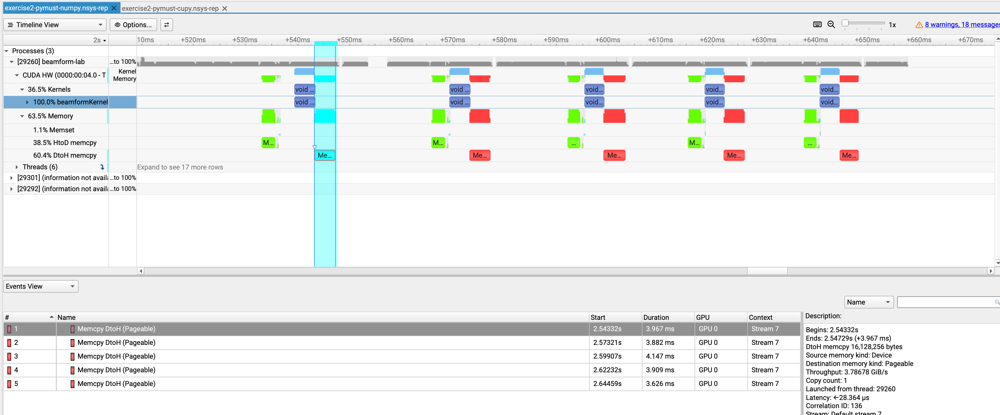
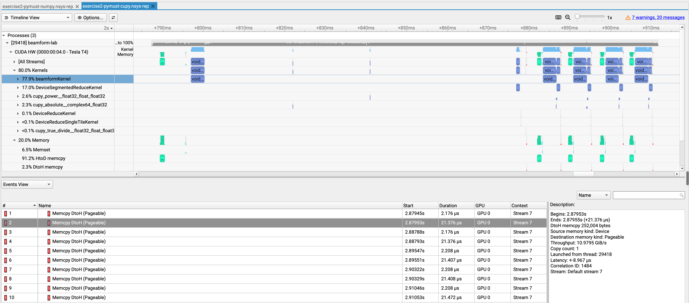
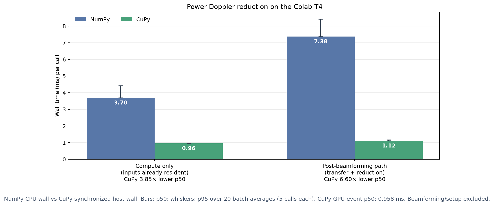
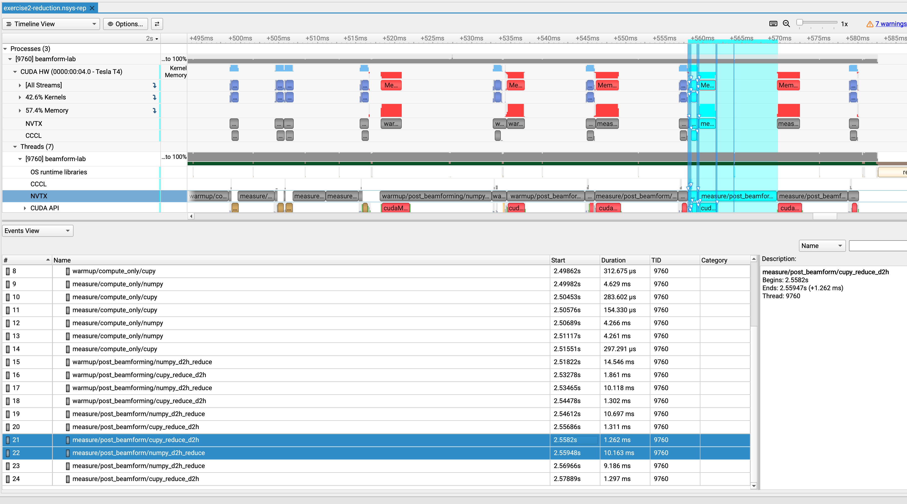
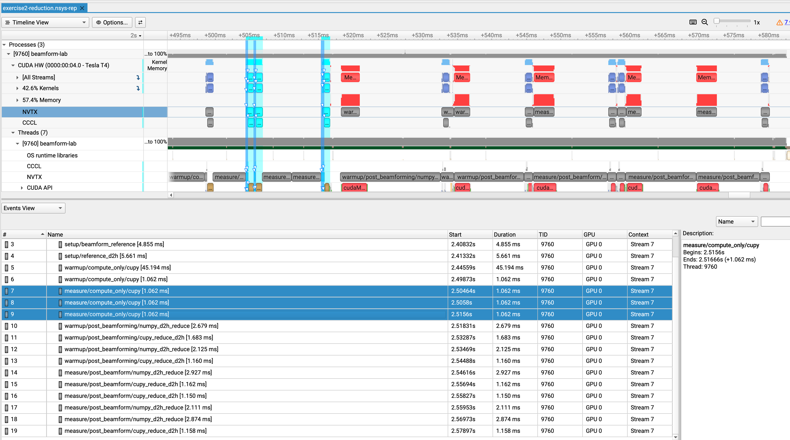

# Exercise 2: reduce before copying to host

The companion [Colab notebook](02-device-side-reduction.ipynb) records the T4 profiling commands, analyzes the saved Nsight Systems exports, checks the output maps, and embeds screenshots from the visualizer.

## Question

Can the pipeline reduce beamformed frames to a Power Doppler map on the GPU and copy back only the final map?

## Part 1: compare the transfer paths

The current `numpy` and `cupy` paths place the ensemble reduction on different sides of the device boundary. Run both with identical inputs and profile the output path. For the default shape, the full complex64 beamformed result is approximately 16.1 MB (`63,001 × 32 × 8` bytes); a float32 Power Doppler map is approximately 0.252 MB (`63,001 × 4` bytes). The output-transfer payload can therefore be 64 times smaller when the reduction happens before D2H transfer.

Inspect transfer sizes and locations in Nsight Systems. Compare output maps numerically and record the measured D2H bytes and elapsed time.


### Nsight Systems screenshots

These are from the earlier five-call end-to-end captures. They show the transfer paths in Part 1; the isolated reducer trace appears in Part 2 below.



Each `beamformKernel` call is followed by a 16,128,256-byte Device-to-Host copy of the beamformed ensemble to pageable host memory (about 16.1 MB). The selected copy took 3.967 ms. The CPU performs the Power Doppler reduction after this transfer.



The kernel tracks show beamforming and Power Doppler work on the GPU. The selected Device-to-Host copy returns the 251 × 251 float32 map (252,004 bytes) and took 21.376 µs; the adjacent 4-byte copy is the scalar summary. Five map-and-scalar pairs appear in the trace.


## Part 2: isolate CPU and GPU reduction time

The unprofiled benchmark now reports an isolated compute-only timing for the NumPy reduction and synchronized host-wall plus GPU-event timings for CuPy. Its second phase reports the complete post-beamforming paths, which include the required transfers. The earlier screenshot's 21.4 µs event is the separate CuPy map transfer; the new isolated reduction trace is `artifacts/exercise2-reduction.nsys-rep`.

`benchmark-reduction` generates one beamformed complex64 ensemble on the T4, then uses the same values for both reducers. Its compute-only phase starts with the array already resident in CPU and GPU memory. Its post-beamforming phase compares the practical paths: copy the full ensemble to the CPU and reduce it, or reduce on the GPU and copy the map and scalar summary to the CPU.

Run the unprofiled benchmark for timing distributions:

```bash
beamform-lab benchmark-reduction --runs 20 --warmup 5 --batch-repeats 5 \
  --output results/exercise2-reduction.json
```

For a short Nsight Systems capture with named stage ranges:

```bash
nsys profile --trace=cuda,nvtx,osrt --sample=none --cpuctxsw=none \
  --output=artifacts/exercise2-reduction \
  beamform-lab benchmark-reduction --runs 3 --warmup 2 --batch-repeats 1 --nvtx
```

NVTX ranges are labels around code stages. Nsight Systems displays them on the CPU timeline and correlates GPU kernels launched inside them. Here they label reference setup, CPU/GPU reduction, and each post-beamforming transfer-and-reduce path. The ranges help identify activity in the trace; use the unprofiled JSON for the timing comparison because profiling adds overhead. No Perfetto trace is required.

### Measured reduction timing on the Colab T4

The saved unprofiled benchmark used 5 warmups and collected 20 timing samples per case; each sample averages 5 calls. The table reports p50 / p95 across those batch averages.

| Phase and timer | NumPy (ms) | CuPy (ms) |
|---|---:|---:|
| Compute only, inputs already resident | 3.704 / 4.426 (CPU wall) | 0.963 / 0.967 (synchronized host wall) |
| Compute only, GPU event timer | — | 0.958 / 0.961 |
| Post-beamforming path: transfer + reduction + mean | 7.380 / 8.415 | 1.118 / 1.176 |

CuPy has 3.85× lower p50 compute-only synchronized wall time and 6.60× lower p50 post-beamforming wall time. The compute-only phase excludes transfers. The post-beamforming phase includes each path's required D2H transfer and reduction; it excludes beamforming and initial setup. It is not live capture-to-display latency, and the combined result does not isolate transfer time from reduction time.



The unprofiled measurements are in [`results/exercise2-reduction.json`](../results/exercise2-reduction.json). The notebook regenerates the chart from that file.

To inspect the isolated report, open `artifacts/exercise2-reduction.nsys-rep` in Nsight Systems. Find the `measure/...` NVTX labels on the Python CPU thread and compare them with **CUDA HW → Kernels** and **CUDA HW → Memory**:

- `measure/compute_only/numpy` is the CPU reduction stage; its NVTX duration is the direct host wall time for the operation.
- `measure/compute_only/cupy` is the host launch span. CuPy kernels can continue after it closes, so read GPU execution on the CUDA Kernels track.
- `measure/post_beamform/numpy_d2h_reduce` includes full-ensemble D2H, NumPy reduction, and mean. The copy is a separate Memory event; CPU sampling is disabled, so the reduction is not split into a separate duration in this trace.
- `measure/post_beamform/cupy_reduce_d2h` includes GPU reduction plus map and scalar copies. The kernels and small D2H events appear on the CUDA tracks.

The trace has two warmups and three measured calls per backend and phase, with the backend order alternating. Nsight timings include profiler overhead; use the unprofiled JSON for the comparison.

In this capture, compute-only NumPy NVTX spans are about 4.3–4.6 ms. CuPy host spans are about 0.15–0.30 ms, but its GPU kernel sequence runs for about 1.1 ms. That shorter CuPy NVTX span is host launch time, not total GPU execution. These profiled values are for locating work; the unprofiled p50 values above are the timing comparison.

### Nsight screenshots: isolated reducer trace

These views are from `artifacts/exercise2-reduction.nsys-rep`. The host view shows CPU-thread NVTX spans; the device view shows the GPU-correlated CuPy ranges. They carry profiler overhead, so use them to locate stages and use the unprofiled JSON for the benchmark comparison.



The `measure/compute_only/numpy` spans show CPU reduction time; the CuPy host spans show launch time. The CuPy kernels continue asynchronously on the GPU.



The three measured `measure/compute_only/cupy` device-correlated ranges each last 1.062 ms in this profile on GPU 0, Stream 7. The 45 ms first-use warmup is not a measured call. The unprofiled CuPy CUDA-event p50 is 0.958 ms.

## Success criteria

- The report documents the byte-count calculation and confirms the observed transfer path in the trace.
- The GPU-reduced output matches the reference within a stated tolerance.
- The benchmark JSON and trace are associated with the same commit and environment.
- The CPU and GPU map reductions use the same beamformed values and agree numerically.
- Compute-only reduction timings are reported separately from each path's required transfer and post-beamforming wall time.

The byte reduction follows from the array shapes; the resulting speedup depends on device and transfer overhead.

Dataset details: [DATA_PROVENANCE.md](../DATA_PROVENANCE.md#active-dataset-pymust-rotating-disk-doppler-phantom).
